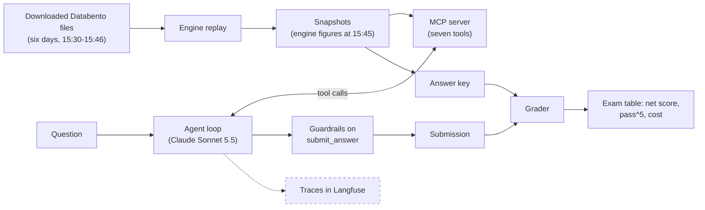

# P1: agent core

**What this page contains.** The spec for phase P1: an agent that answers SPX options questions
from frozen engine figures through an MCP server, finishes with a checked submission, and is
scored by an exam. User stories, decisions, how it is tested, and what is left out.

**How to read it.** Start with the problem and solution, then the diagram. Decisions link to their
records in `docs/design/decisions/`; words in bold are defined in `CONTEXT.md`; the evidence behind
the design is in `docs/research/p1-references.md`. Tickets are sub-issues of this spec's issue.

**Status.** Design phase (2026-10-14). Nothing here is built.

## Problem Statement

Lalit wants to become properly good at applied AI engineering (agents, tools, MCP, evals,
guardrails) by building, not by having an AI write it. An earlier project, PaperLens, looked
finished but its benchmark numbers were made up and its evaluation never worked, because nothing
it answered had a checkable right answer. P1 needs an agent whose every answer can be checked
exactly, a way to measure it honestly, and a build order in which Lalit writes every new concept
by hand.

## Solution

An agent that answers plain-English questions about SPX options as of 15:45 New York time on six
frozen **snapshot days**, using only figures produced by the Convex Hedge **engine**
([0001](../design/decisions/0001-calculations-come-from-the-engine.md)). The engine is replayed
over the downloaded Databento files once, and what it publishes becomes the **snapshots**
([0002](../design/decisions/0002-answer-key-by-engine-replay.md),
[0003](../design/decisions/0003-questions-are-as-of-1545-on-frozen-days.md)). An **MCP server**
offers about seven high-level **tools** over the snapshots
([0006](../design/decisions/0006-seven-high-level-tools.md)). A hand-written **agent loop**
([0005](../design/decisions/0005-hand-written-agent-loop.md)) lets Claude Sonnet 5.5 call those
tools and finish only through a checked `submit_answer` call
([0007](../design/decisions/0007-submit-answer-is-the-only-exit.md)). An **exam** in Inspect AI
scores it with negative marking and pass^k
([0008](../design/decisions/0008-negative-marking.md),
[0009](../design/decisions/0009-exam-in-inspect-with-own-grader.md)), and every run is traced to
Langfuse Cloud ([0010](../design/decisions/0010-p1-traces-to-langfuse-cloud.md)).

Notice that the snapshots feed both the tools and the answer key: the agent and the grader see the
same engine figures, so a wrong answer is the agent's mistake, never the data's. Tracing (dashed)
observes the loop without changing it.

## User Stories

1. As Lalit, I want every figure to come from the engine's unchanged code, so that a rewrite can never quietly disagree with the firm's research.
2. As Lalit, I want the engine replayed over the downloaded files to produce the snapshots, so that the engine's own quote selection is used.
3. As Lalit, I want one snapshot per snapshot day at 15:45 New York time, so that every question has exactly one right answer.
4. As Lalit, I want the snapshot builder checked against the engine's own output for one day, so that I can trust the answer key.
5. As Lalit, I want the stored Backtest-Engine figures used only as a cross-check, so that disagreements between the two pipelines surface as findings.
6. As Lalit, I want raw Databento files and credentials kept out of git, so that the repo can go public without breaking the data licence.
7. As Lalit, I want a fetch script with a checksum manifest, so that the six days can be downloaded again and verified.
8. As an analyst, I want to ask which snapshot days exist, so that I know what I can ask about.
9. As an analyst, I want to list the expiries on a snapshot day, so that I can pick one.
10. As an analyst, I want a capped view of an expiry's chain around the forward, so that I can see quotes, IV and greeks without a flood of rows.
11. As an analyst, I want an expiry's skew figures (ATM IV, 25-delta put and call, 10-delta put, slopes, risk reversal), so that I can judge how dear puts are.
12. As an analyst, I want realised volatility since the open and over 20 sessions, with the implied-realised gap, so that I can tell whether options were rich or cheap.
13. As an analyst, I want an expiry's implied move, so that I know what move the straddle priced.
14. As an analyst, I want gamma exposure with the gamma flip and the walls, for the 0DTE expiry or all expiries, so that I can see where hedging flows may push the index.
15. As an analyst, I want term-structure questions (ATM IV across expiries) answered, so that I can see whether the market feared the near term or the far term.
16. As an analyst, I want every number in an answer to carry its unit, so that 0.18, 18% and 18 vol points are never confused.
17. As an analyst, I want every number to cite the figure it came from, so that I can trace it to the engine.
18. As an analyst, I want the answer's sources (snapshot, as-of time, engine version) filled in automatically, so that provenance is always right.
19. As an analyst, I want "cannot answer" with the missing data listed when the data does not support a question, so that I never get an invented number.
20. As the agent, I want a wrong input (a date or expiry that does not exist) to return an error listing the valid values, so that I can retry correctly.
21. As the agent, I want a valid request whose figure does not exist (no gamma flip in range, no 25-delta point near expiry) to return a normal result saying so, so that I can choose `cannot_answer`.
22. As the agent, I want tool descriptions that state units, conventions and what each tool does not return, so that I pick the right tool with the right arguments.
23. As the agent, I want `get_chain` to tell me how to narrow the request when it truncates, so that I can ask again.
24. As the agent, I want my submission checked and rejected with a precise message when a number matches no figure, so that I can fix it before it counts.
25. As the agent, I want the marking rule (+1, 0, -3) in my instructions, so that I answer only when more than 75% sure.
26. As Lalit, I want the agent loop to stop after a fixed number of turns, tokens or dollars, so that a confused run cannot burn the budget.
27. As Lalit, I want a model that stops without submitting to get at most two nudges and then be recorded as "no submission", so that every trial ends in a defined outcome.
28. As Lalit, I want the loop to pass thinking blocks back unchanged and handle every stop reason, so that Sonnet 5.5 behaves correctly across turns.
29. As Lalit, I want parallel tool calls run and returned together, so that the model keeps using them.
30. As Lalit, I want prompt caching on the system prompt and tool list, so that repeated turns cost less.
31. As Lalit, I want the agent loop to start the MCP server itself, list its tools and convert them for the Messages API, so that the server and the loop are tested as one path.
32. As Lalit, I want an exam of about 10 questions to start, including unanswerable ones, so that both answering and refusing are scored.
33. As Lalit, I want the grader built and tested against hand-written fake submissions before any agent exists, so that grading bugs are caught first.
34. As Lalit, I want tolerance set per figure and units compared exactly, so that rounding is not punished and unit mistakes are.
35. As Lalit, I want each question run five times and reported as pass^5, so that I see reliability, not luck.
36. As Lalit, I want the exam table to show net score, correct, incorrect, not attempted, pass^5, cost per question and time per question, so that I can compare versions honestly.
37. As Lalit, I want the exam to grow to about 30 questions with 10 held out, so that tuning does not overfit the score.
38. As Lalit, I want the question set versioned, so that scores from different versions are never compared by mistake.
39. As Lalit, I want every run traced to Langfuse, so that I can open a failed question and see each tool call.
40. As Lalit, I want an `ask` command that answers one question in the terminal, so that I can try the agent by hand.
41. As Lalit, I want each new concept built by me with resources and an explanation first, so that I can explain every line.
42. As Lalit, I want plumbing and repeats built by the feature loop, so that my hours go to new concepts.
43. As Lalit, I want to write the "why" of every decision record myself, so that I can defend each decision in an interview.
44. As a reviewer reading the repo, I want a README with the exam table and its limits, so that I can judge the work in a minute.

## Implementation Decisions

- **Modules.** Five deep modules with small interfaces:
  - *Snapshot builder* (`glue`): files in, one snapshot per snapshot day out, by engine replay plus the engine's realised-volatility functions over index candles.
  - *Snapshot store*: read-only access to snapshots by day and expiry; the only thing the MCP server reads.
  - *MCP server*: the seven tools over the snapshot store, stdio transport, built on the MCP Python SDK v2 (spec 2026-07-28, stateless).
  - *Agent*: "question in, outcome out" (a submission, or no submission with its reason), owning the loop, the MCP client side, budgets, nudges and guardrails.
  - *Exam*: questions, answer key, grader and the Inspect task that runs the agent.
- **Tools.** `list_dates`, `list_expiries(date)`, `get_chain(date, expiry, strikes_each_side)`, `get_skew(date, expiry)`, `get_realised_vol(date, kind)`, `get_implied_move(date, expiry)`, `get_gamma_exposure(date, scope)`. `kind` and `scope` are enums. Return types are declared models, so the server publishes an output schema and structured content. Every result carries the snapshot, the as-of time with its New York offset, the engine version, units and figure ids. Annotations: read-only, closed-world. Tools listed in a fixed order.
- **Two kinds of "no data".** An invalid input raises a tool error that lists valid values. A valid request whose figure does not exist returns a normal result saying so.
- **Tool contracts first.** Lalit writes all seven tool contracts (name, parameters, description, errors) in #5; #6 implements the other five to those contracts word for word.
- **Answer form** (delivered as the `submit_answer` input, strict schema): `status` (`answered` | `cannot_answer`), `answer` (prose), `numbers` (each: name, value, unit from the unit list, figure id), `missing_data` (list). `sources` is not in the form; the loop derives it from the cited figure ids. Every field is required; no numeric bounds; no field called "reasoning"; units compared case-insensitively. Settled in #9.
- **Derived numbers.** Comparisons such as the implied-realised gap come from the tools (the engine computes them), never from the agent's arithmetic.
- **Guardrails** run on each `submit_answer` call: every number matches a figure a tool returned in this run (same figure id, same value at its precision, same unit); `cannot_answer` lists missing data. A failure returns a tool error naming the problem.
- **Budgets.** About 10-12 turns, a per-call `max_tokens`, a per-question cost cap, a separate cap of 3 on malformed calls. At most two nudges.
- **Model.** Claude Sonnet 5.5 for every run, thinking on (its default), tool choice `auto` (forced tool use is rejected by this model).
- **Scoring.** +1 correct, 0 `cannot_answer` or not attempted, -3 incorrect; on unanswerable questions `cannot_answer` is correct. Reported with correct / incorrect / not attempted counts, pass^5, cost and time per question.
- **Exam runner.** Inspect AI; the hand-written loop runs inside it through the agent bridge, with per-question cost and message limits; five epochs.
- **Tracing.** OpenTelemetry with the Anthropic instrumentation into Langfuse Cloud (Python SDK v4); the MCP server's own spans join the trace.
- **Data.** Six snapshot days pulled 2026-10-14 (see `docs/roadmap.md`), all expiries, `definition`, `statistics` and `cbbo-1s` for 15:30-15:46; the year of 0DTE data and index candles from the Backtest-Engine data folder for realised volatility. Raw data stays out of git ([0004](../design/decisions/0004-raw-data-and-credentials-stay-out-of-git.md)).

## Testing Decisions

- **A good test checks behaviour through a public boundary**, never internals: what a tool returns for a request, what outcome a question produces, what mark a submission gets. Tests are written first (red, green, refactor).
- **Three seams**, the highest available:
  1. *MCP boundary*: tests call tools through the SDK's in-memory client, exactly as the agent does; no subprocess, no API cost. Covers results, provenance, both kinds of "no data", truncation.
  2. *Agent-run boundary*: "question in, outcome out" with a fake model that replays scripted responses. Covers budgets, nudges, guardrail rejections, thinking-block pass-through, stop reasons, parallel calls. Real Claude runs only in the exam.
  3. *Grader boundary*: a submission and an answer key entry in, correct / incorrect / not attempted out, tested against hand-written fake submissions.
- **Snapshot builder** is checked separately: for one snapshot day its output must equal the engine's own published figures at 15:45.
- **Prior art.** None in this repo yet. The MCP SDK's testing guide (in-memory client with pytest and anyio) and Inspect's own scorer tests are the patterns to follow; see `docs/research/p1-references.md`.

## Out of Scope

- Any backend service, queue, database, streaming or web UI (P2).
- The streamable HTTP transport for the MCP server (P2).
- Multi-agent orchestration, LangGraph, Upstox data, load tests (P3).
- Cloud deployment and self-hosted Langfuse (P4); self-hosted models (P5).
- An LLM judge: numbers are graded by code; a judge is added only if error analysis shows the prose contradicting the numbers.
- Stress scenarios that need a new calculation at question time.
- Times of day other than 15:45, and days other than the snapshot days.

## Further Notes

- **Assumptions.** The engine can replay the downloaded Databento files offline with its own file mode; the firm's permission to use its code continues; the exam's 10 questions fit about $1 per full run of five trials.
- **Learning.** `learn` tickets carry resources from `docs/research/p1-references.md` §6 and the decision records whose "why" Lalit writes. Feature-loop builds only `glue` tickets.
- The Backtest-Engine data's timestamps are shifted by 5h30; the snapshot builder must correct them.
